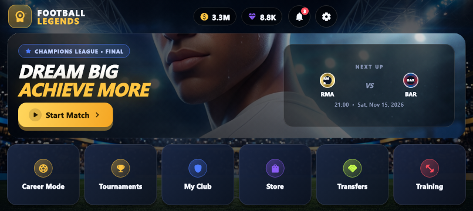
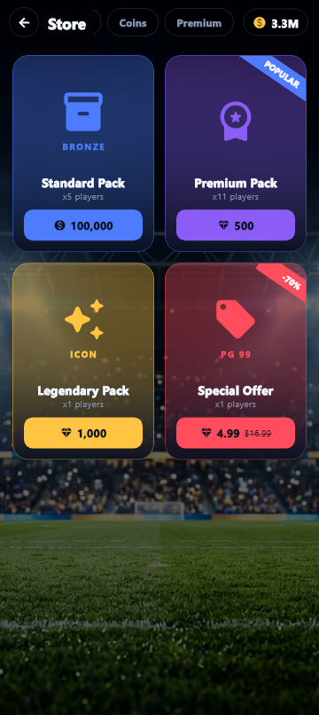
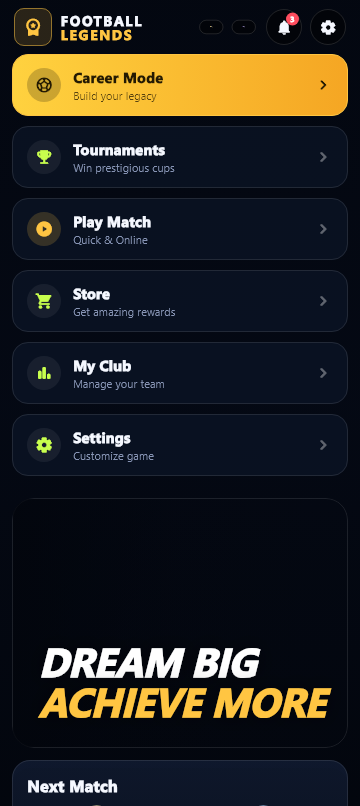

# ⚽ Fodball 3D

**To'liq 3D futbol o'yini** — Flutter bilan yozilgan, tashqi 3D paket va assetlarsiz.
Football Legends uslubidagi menyu, eFootball uslubidagi jamoa boshqaruvi va 11x11 3D
o'yin bilan.

## Skrinshotlar

| Home (landshaft) | My Team — 4-3-3 |
| --- | --- |
|  |  |

| 11x11 o'yin | Store |
| --- | --- |
|  |  |

| Home (portret) |
| --- |
|  |

## O'yin rejimi

### 1. Penalti (TRAINING)

- **10 ta penalti** — har zarba hisoblanadi: `GOAL!`, `SAVED`, `MISS`.
- **Boshqaruv:** barmoq bilan sudrab nishonga oling (kuch shkalasi to'ladi) va qo'yib yuboring;
  yoki shunchaki kerakli nuqtaga bosing.
- **Banan effekti** — kuchliroq zarbada to'p yon tomonga buriladi.
- **Darvozabon AI** — har zarbada zarba yo'nalishini "o'qish" ehtimoli oshadi (42% → 88%),
  past/yuqori burchakka tashlanadi.
- **FULL TIME** — gol soni, aniqlik foizi, eng uzun seriya, `PLAY AGAIN` va `MENU`.

### 2. 11x11 o'yin (PLAY MATCH)

- **To'liq 3D match**: 22 o'yinchi, to'p fizikasi, egallik/olib qochish logikasi.
- **Boshqaruv**: floating joystick + `SHOOT` / `PASS` / `SPRINT` tugmalari.
- **AI jamoa**: o'yinchilar pozitsiya sxemasiga qarab harakatlanadi, press qiladi,
  pas va zarba qiladi; darvozabon to'pni kuzatadi.
- **Match clock**: real vaqt 90 daqiqaga map qilinadi.
- **Minimap**: chap pastki burchakda jonli xarita.
- **UCL Final**: finalni yutsangiz `CHAMPIONS!` ekrani ochiladi.

## O'yin ichidagi ekranlar

| Ekran | Tavsif |
| --- | --- |
| **Home** | Football Legends uslubidagi menyu: profil, daraja, valyuta, Next Match, LALIGA jadvali |
| **My Team** | 4-3-3 tarkib, Team Power, statistika paneli, taktika (sxema, uslub), yangilash |
| **Career** | Statistika: o'yinlar, gollar, o'sish grafigi |
| **Tournaments** | UCL finaliga qadar jonli countdown |
| **Transfers** | Transfer bozori: sotib olish / sotish |
| **Training** | Penalti rejimi kirish nuqtasi |
| **Achievements** | Yutuqlar va sovg'alarni yig'ish |
| **Store** | Paketlar (ochish animatsiyasi bilan), o'yinchilar, coins, premium |
| **Settings** | Mavzu, haptik, match uzunligi, haqida |
| **Champions** | Chempionlik ekrani |

## 3D dvigatel

Tashqi paket yo'q — `CustomPainter` va o'zimizning proyeksiya matematikasi:

| Fayl | Vazifa |
| --- | --- |
| `lib/game3d/vec3.dart` | `V3` vektor, `Camera3D`, `Projector` (`project`, `unproject`, `scaleAt`) |
| `lib/game3d/penalty_game.dart` | Penalti fizikasi, darvozabon AI, konfetti |
| `lib/game3d/game_painter.dart` | Penalti 3D sahna: osmon, tribuna, maydon, darvoza, to'r |
| `lib/game3d/match_game.dart` | 11x11 match dvigatel: AI, fizika, scoreboard |
| `lib/game3d/match_painter.dart` | Match 3D sahna: keng maydon, murakkab chiziq va o'yinchilar |

Kamera: ko'z `(0, 1.75, -9.6)`, qarash `(0, 1.15, 0)`, `fovY = 0.92`.
Darvozaning real o'lchamlari: 7.32 × 2.44 m, to'p radiusi 0.11 m.
Match maydoni: 105 × 68 m.

## Ishga tushirish

### Android Studio

1. **File → Open** → `fodball` papkasini tanlang.
2. Flutter SDK sozlangan bo'lishi kerak (**Settings → Languages & Frameworks → Flutter**).
3. Yuqori o'ng burchakda qurilma tanlang (telefon yoki emulyator).
4. **Run** (`Shift + F10`) — `main.dart` run configuration tayyor.

> Qurilma ko'rinmasa: telefonni USB bilan ulang, **USB debugging** ni yoqing va telefonda **Allow** bosing.
> Tekshirish: `flutter devices`.

### Terminal

```bash
flutter pub get
flutter run                # ulangan qurilma
flutter run -d chrome      # brauzer
```

### APK

```bash
flutter build apk --release
# build/app/outputs/flutter-apk/app-release.apk
```

## Tuzilma

```
lib/
├─ main.dart                       # kirish nuqtasi
├─ game3d/
│  ├─ vec3.dart                    # 3D vektor, kamera, proyeksiya
│  ├─ penalty_game.dart            # penalti logikasi, fizika, darvozabon AI
│  ├─ game_painter.dart            # penalti 3D renderer
│  ├─ match_game.dart              # 11x11 match dvigatel
│  └─ match_painter.dart           # match 3D renderer
├─ screens/
│  ├─ home_screen.dart             # Football Legends menyusi
│  ├─ team_screen.dart             # My Team (4-3-3)
│  ├─ match_screen.dart            # 11x11 o'yin ekrani
│  ├─ game_screen.dart             # penalti ekrani
│  ├─ store_screen.dart            # do'kon
│  ├─ career_screen.dart           # karyera
│  ├─ tournaments_screen.dart      # turnirlar
│  ├─ transfers_screen.dart        # transfer bozori
│  ├─ training_screen.dart         # penalti kirish nuqtasi
│  ├─ achievements_screen.dart     # yutuqlar
│  ├─ settings_screen.dart         # sozlamalar
│  └─ champions_screen.dart        # chempionlik
├─ state/game_state.dart           # umumiy o'yin holati
├─ theme/
│  ├─ app_colors.dart
│  └─ app_theme.dart
├─ models/models.dart
├─ data/mock_data.dart
└─ widgets/ui.dart                 # umumiy UI komponentlari
```

## Sifat nazorati

```bash
flutter analyze   # 0 issue
flutter test      # 29 test: 3D proyeksiya, fizika, match AI, UI overflow
```

---

Flutter bilan ❤️ bilan yozilgan.
