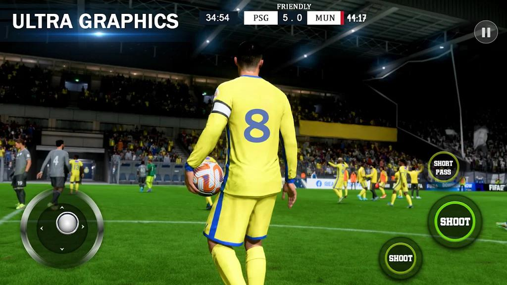
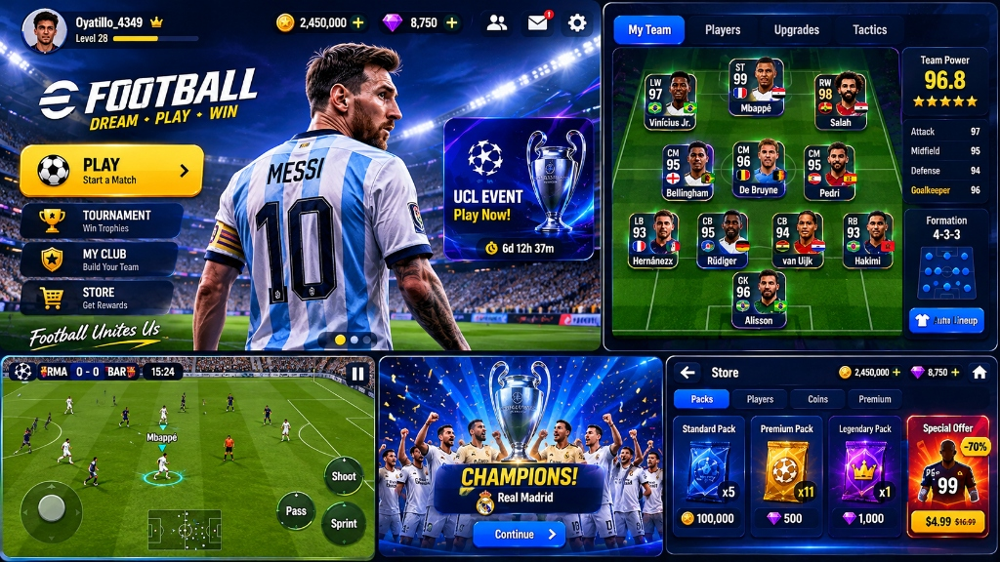
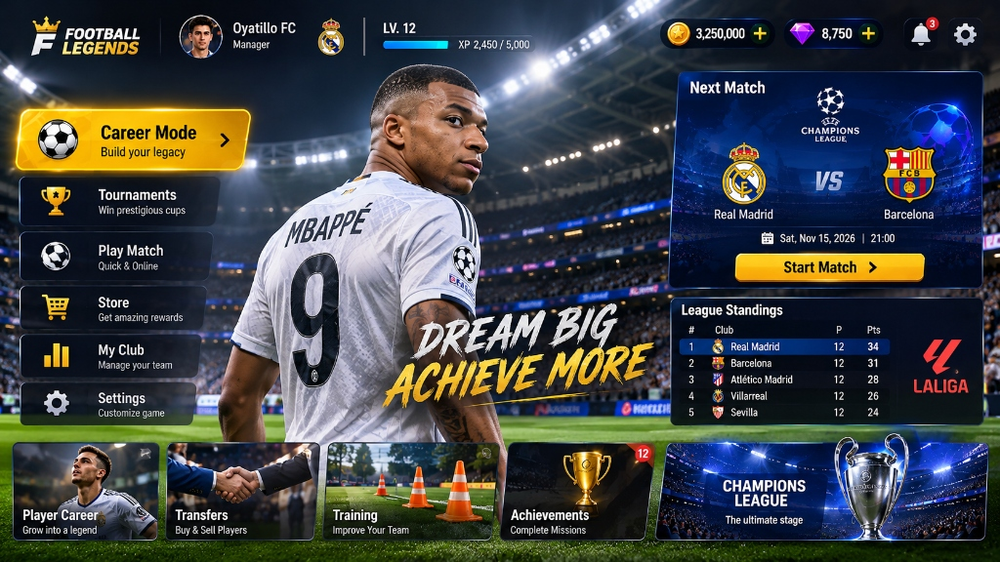
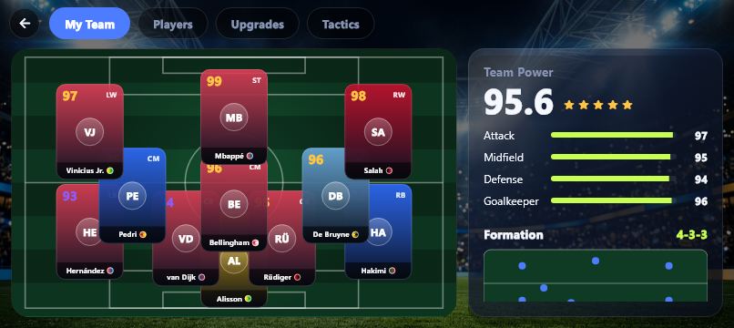
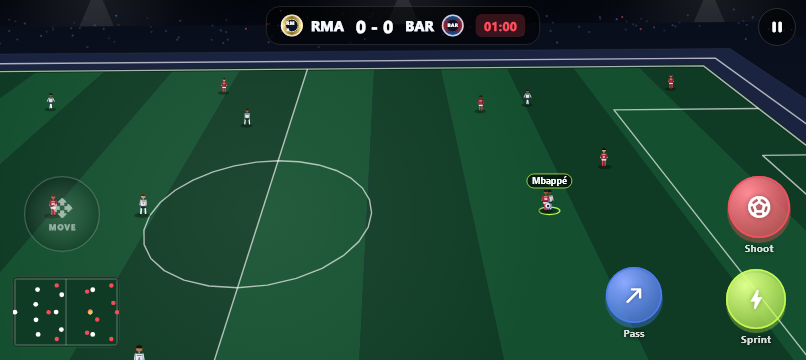

# ⚽ Fodball 3D — Flutter Football Game

<div align="center">


**To'liq 3D futbol o'yini** — Flutter bilan yozilgan, tashqi 3D paket va asset'larsiz.
Faqat `CustomPainter` va matematik proyeksiya yordamida yaratilgan real-time 3D render.

[📥 Yuklab olish](#-oʻrnatish) · [🎮 O'ynash](#-oyin-rejimlari) · [📸 Skrinshotlar](#-skrinshotlar) · [🏗️ Arxitektura](#️-arxitektura)

</div>

---

## 📸 Skrinshotlar

### 🎮 3D O'yin (Ultra Graphics)
<div align="center">

</div>

> Real-time 3D render: stadion, 22 o'yinchi, to'p fizikasi, joystick boshqaruvi, minimap — hammasi `CustomPainter` bilan.

### 🏠 Bosh Menyu — eFootball & Football Legends Style
<table>
<tr>
<td></td>
<td></td>
</tr>
<tr>
<td align="center"><b>eFootball</b> — My Team, Store, UCL Event</td>
<td align="center"><b>Football Legends</b> — Career, Next Match, League</td>
</tr>
</table>

### 📱 Ilova ichidagi ekranlar
| Home (Landshaft) | My Team — 4-3-3 |
|---|---|
|  |  |

| 11×11 O'yin | Store |
|---|---|
|  |  |

---

## ✨ Asosiy Xususiyatlar

### 🎮 O'yin Mexanikasi
- **11v11 To'liq 3D Match** — 22 o'yinchi, to'p fizikasi, AI jamoa
- **Penalti Rejimi** — 10 ta penalti, banan effekti, darvozabon AI
- **Real-time 3D Render** — `CustomPainter` + matematik proyeksiya, tashqi 3D kutubxonalarsiz
- **Fizika Dvigatel** — gravitatsiya, to'qnashish, to'p uchishi, bounce mexanikasi
- **AI Futbolchilar** — pozitsiya sxemasiga qarab harakatlanish, press, pas va zarba

### 🕹️ Boshqaruv
- **Floating Joystick** — ekranning chap yarmida istalgan joydan
- **Harakat Tugmalari** — `SHOOT`, `PASS`, `SPRINT`
- **Penalti Nishon** — barmoq bilan tortib nishonga olish + kuch shkalasi

### 📊 Menejment Tizimi
- **Tarkib Boshqaruvi** — 4-3-3, 4-4-2, 3-5-2 formatsialar
- **O'yinchi Almashtirish** — drag & swap, auto lineup
- **Team Power** — real-time o'rtacha reytingni hisoblash
- **Transfer Bozori** — o'yinchilarni sotib olish va sotish
- **Career Mode** — statistika, daraja, tajriba o'sishi
- **Turnirlar** — UCL finaliga countdown + Champions ekrani

### 🏪 Do'kon & Iqtisodiyot
- **Pack System** — Standard, Premium, Legendary paketlar
- **Pack Reveal Animation** — ochish animatsiyasi
- **Ikki Valyuta** — Coins va Gems
- **Yutuqlar** — Missiyalar va mukofotlar

### 🎨 Dizayn
- **Football Legends UI** — premium qorong'u tema
- **eFootball Style** — My Team boshqaruv paneli
- **Responsive Layout** — 3 xil tartib: keng, planshet, telefon
- **Scroll Yo'q** — barcha navigatsiya faqat tugmalar orqali
- **Material Design 3** — zamonaviy Flutter UI

---

## 🏗️ Arxitektura

```
lib/
├── main.dart                    # Ilova entry point
├── data/
│   └── mock_data.dart           # O'yinchilar, klublar, do'kon ma'lumotlari
├── game3d/                      # 🎮 3D O'yin Dvigatel
│   ├── vec3.dart                # 3D vektor matematikasi (V3)
│   ├── match_game.dart          # 11v11 o'yin logikasi (601 qator)
│   ├── match_painter.dart       # 3D match render (753 qator)
│   ├── penalty_game.dart        # Penalti o'yin logikasi (352 qator)
│   └── game_painter.dart        # 3D penalti render (644 qator)
├── models/
│   └── models.dart              # Player, Club, MatchInfo, Pack, Achievement, ...
├── screens/                     # 📱 Ekranlar
│   ├── home_screen.dart         # Bosh menyu (3 layout: wide/compact/portrait)
│   ├── match_screen.dart        # 11x11 3D o'yin + HUD + joystick + tugmalar
│   ├── game_screen.dart         # Penalti 3D o'yini
│   ├── team_screen.dart         # My Team — tarkib boshqaruvi
│   ├── store_screen.dart        # Do'kon — paketlar, o'yinchilar, valyuta
│   ├── career_screen.dart       # Career statistikasi
│   ├── tournaments_screen.dart  # Turnirlar va UCL countdown
│   ├── transfers_screen.dart    # Transfer bozori
│   ├── training_screen.dart     # Training — penalti rejimiga kirish
│   ├── achievements_screen.dart # Yutuqlar va mukofotlar
│   ├── champions_screen.dart    # 🏆 Chempionlik tantanasi
│   └── settings_screen.dart     # Sozlamalar
├── state/
│   └── game_state.dart          # Markaziy holat boshqaruvi (ChangeNotifier)
├── theme/
│   ├── app_colors.dart          # Rang palitrasi (20+ rang)
│   └── app_theme.dart           # Material 3 dark tema
└── widgets/
    └── ui.dart                  # Qayta foydalaniladigan widgetlar (ClubCrest, CurrencyPill, ...)
```

### Texnik Tafsilotlar

| Komponent | Texnologiya |
|---|---|
| **3D Render** | `CustomPainter` + perspektiv proyeksiya matritsasi |
| **Fizika** | O'zining fizika dvigatel: gravitatsiya, to'qnashish, bounce |
| **AI** | Formation-based pozitsiyon AI + press + pas zanjiri |
| **Holat** | `ChangeNotifier` + `InheritedWidget` (`GameStateScope`) |
| **Animatsiya** | `Ticker` + `AnimatedBuilder` (60fps game loop) |
| **Responsive** | `LayoutBuilder` — 3 layout breakpoint (1120px, 620px) |
| **Render Loop** | `Ticker.createTicker()` → `game.tick(dt)` → `CustomPainter.paint()` |

### Arxitektura Diagrammasi

```
┌──────────────────────────────────────────────────────────────┐
│                        FodballApp                            │
│  ┌────────────────────────────────────────────────────────┐  │
│  │              GameStateScope (InheritedWidget)          │  │
│  │  ┌──────────────────────────────────────────────────┐  │  │
│  │  │            GameState (ChangeNotifier)             │  │  │
│  │  │  coins, gems, squad, table, achievements, ...    │  │  │
│  │  └──────────────────────────────────────────────────┘  │  │
│  │                         │                              │  │
│  │  ┌──────────┐  ┌───────┴────────┐  ┌──────────────┐   │  │
│  │  │  Screens │  │   Game3D       │  │   Widgets    │   │  │
│  │  │          │  │ ┌────────────┐ │  │ ClubCrest    │   │  │
│  │  │  Home    │  │ │MatchGame   │ │  │ CurrencyPill │   │  │
│  │  │  Match ──┼──┤ │PenaltyGame │ │  │ PlayerCard   │   │  │
│  │  │  Team    │  │ │MatchPainter│ │  │ ...          │   │  │
│  │  │  Store   │  │ │GamePainter │ │  └──────────────┘   │  │
│  │  │  ...     │  │ └────────────┘ │                      │  │
│  │  └──────────┘  └────────────────┘                      │  │
│  └────────────────────────────────────────────────────────┘  │
└──────────────────────────────────────────────────────────────┘
```

---

## 🎮 O'yin Rejimlari

### 1. ⚽ 11x11 To'liq Match (Play Match)

| Xususiyat | Tavsif |
|---|---|
| **O'yinchilar** | 22 ta (11v11) — har birining pace, shooting, passing statistikasi |
| **Fizika** | Gravitatsiya, to'p bounce, darvoza to'ri |
| **Boshqaruv** | Floating joystick + Shoot/Pass/Sprint tugmalari |
| **Kamera** | 3D — o'yinchini kuzatib yuradi |
| **Minimap** | Chap pastki burchakda real-time xarita |
| **Hisob** | Real vaqt 90 daqiqaga map qilinadi |
| **Gol** | Animatsiya + konfetti + haptik feedback |
| **Full Time** | Natija + mukofotlar + jadval yangilanishi |
| **UCL Final** | G'alaba = `CHAMPIONS!` ekrani 🏆 |

### 2. 🥅 Penalti (Training)

| Xususiyat | Tavsif |
|---|---|
| **Zarbalar** | 10 ta penalti |
| **Nishon** | Barmoq bilan tortib yo'naltirish + kuch shkalasi |
| **Banan** | Kuchliroq zarbada yon burilish effekti |
| **Darvozabon** | AI — zarba yo'nalishini o'qish ehtimoli oshadi (42% → 88%) |
| **Natijalar** | GOAL!, SAVED, MISS — har zarba alohida |
| **Statistika** | Gol soni, aniqlik %, eng uzun seriya |

---

## 📱 Ekranlar Ro'yxati

| # | Ekran | Tavsif |
|---|---|---|
| 1 | **Home** | Football Legends menyu: profil, daraja, valyuta, Next Match, LALIGA jadvali |
| 2 | **My Team** | 4-3-3 / 4-4-2 / 3-5-2 tarkib, Team Power, o'yinchi almashtirish |
| 3 | **Match** | 11×11 3D o'yin — joystick, tugmalar, minimap, hisob |
| 4 | **Training** | Penalti rejimi (3D) |
| 5 | **Career** | Statistika: o'yinlar, gollar, assistlar, o'sish |
| 6 | **Tournaments** | UCL finaliga jonli countdown |
| 7 | **Transfers** | Transfer bozori: sotib olish / sotish |
| 8 | **Store** | Paketlar (ochish animatsiyasi), o'yinchilar, coins, premium |
| 9 | **Achievements** | Yutuqlar va sovg'alar |
| 10 | **Settings** | Mavzu, haptik, match uzunligi |
| 11 | **Champions** | 🏆 Chempionlik tantanasi ekrani |

---

## 📥 O'rnatish

### Talablar

- **Flutter** 3.47.5+ (Dart 3.13+)
- **Android Studio** yoki **VS Code**
- Android / iOS / Web emulator yoki qurilma

### Qadamlar

```bash
# 1. Repositoryni klonlash
git clone https://github.com/oyatillosadullayev55-u/fodball.git
cd fodball

# 2. Dependencylarni o'rnatish
flutter pub get

# 3. Ishga tushirish
flutter run                    # Ulangan qurilmada
flutter run -d chrome          # Web brauzerda
flutter run -d android         # Android qurilmada

# 4. Release build
flutter build apk --release    # Android APK
flutter build web --release    # Web
flutter build ios --release    # iOS
```

---

## 🛠️ Texnologiyalar

| Texnologiya | Maqsad |
|---|---|
| **Flutter 3.47.5** | Cross-platform UI framework |
| **Dart 3.13+** | Dasturlash tili |
| **CustomPainter** | 3D render (tashqi paketlarsiz) |
| **ChangeNotifier** | Holat boshqaruvi |
| **InheritedWidget** | State injection (GameStateScope) |
| **Ticker** | 60fps game loop |
| **Material Design 3** | UI dizayn tizimi |

---

## 📊 Loyiha Statistikasi

| Ko'rsatkich | Qiymat |
|---|---|
| **Dart fayllari** | 24 ta |
| **Kod qatorlari** | 9,700+ |
| **3D Dvigatel** | ~2,350 qator (game3d/) |
| **Ekranlar** | 11 ta |
| **Tashqi paketlar** | 0 (faqat Flutter SDK) |
| **Platformalar** | Android, iOS, Web |

---

## 👨‍💻 Muallif

**Oyatillo Sadullayev**

- GitHub: [@oyatillosadullayev55-u](https://github.com/oyatillosadullayev55-u)

---

## 📄 Litsenziya

Ushbu loyiha MIT litsenziyasi ostida tarqatiladi.

---

<div align="center">

**⭐ Agar loyiha yoqdimi? Yulduzcha qo'yishni unutmang!**

</div>
