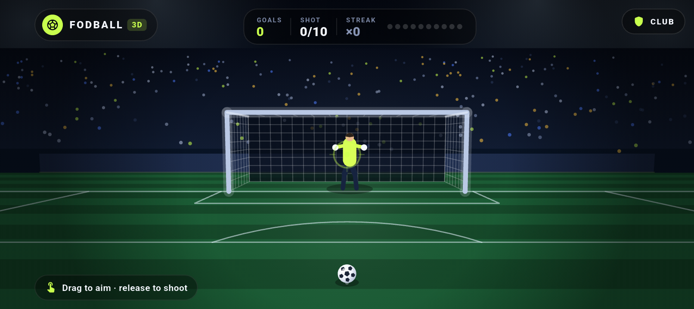
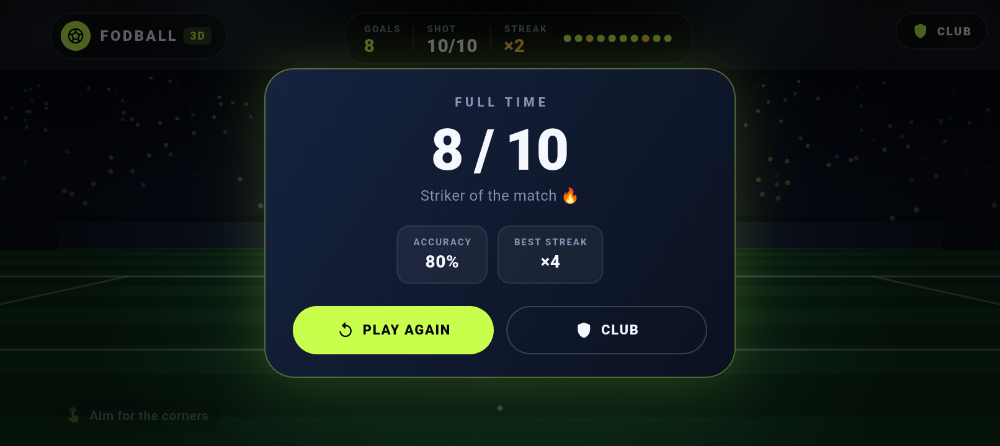
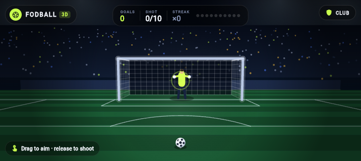
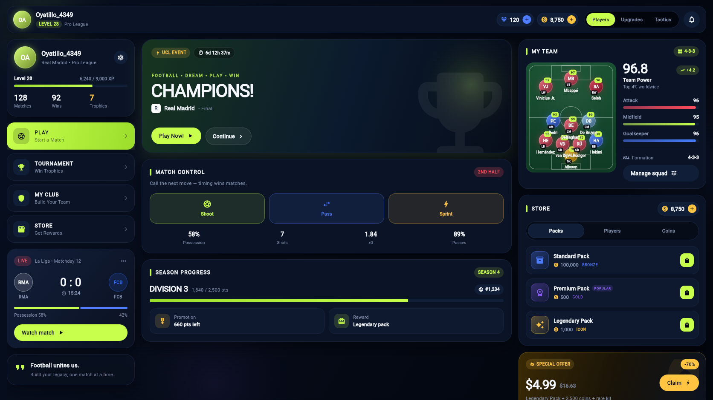
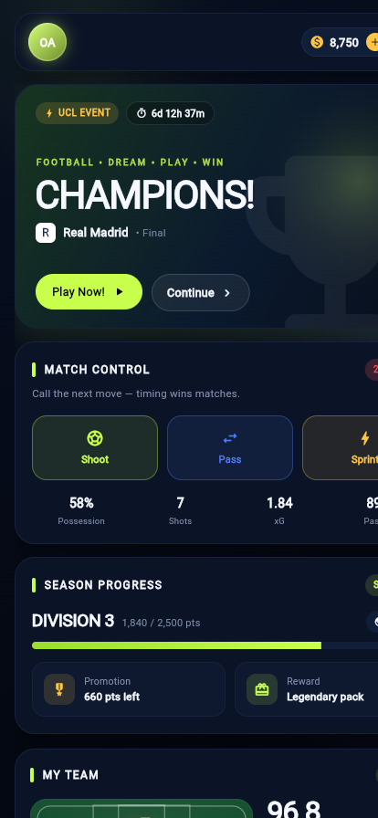

# ⚽ Fodball 3D

**O'ynaladigan 3D penalti o'yini** — Flutter bilan yozilgan, tashqi 3D paket va assetlarsiz.
Haqiqiy perspektiv kamera, uch o'lchamli maydon, darvoza va to'r, fizika hamda darvozabon
sun'iy intellekti.



## Skrinshotlar

| O'yin — 1612×720 | FULL TIME | Brauzer — 716×320 |
| --- | --- | --- |
|  |  |  |

## O'yin

- **10 ta penalti** — har zarba hisoblanadi: `GOAL!`, `SAVED`, `MISS`.
- **Boshqaruv:** barmoq bilan sudrab nishonga oling (kuch shkalasi to'ladi) va qo'yib yuboring;
  yoki shunchaki kerakli nuqtaga bosing.
- **Banan effekti** — kuchliroq zarbada to'p yon tomonga buriladi.
- **Darvozabon AI** — har zarbada zarba yo'nalishini "o'qish" ehtimoli oshadi (42% → 88%),
  past/yuqori burchakka tashlanadi.
- **Streak** — ketma-ket gollar, eng uzun seriya saqlanadi.
- **FULL TIME** — gol soni, aniqlik foizi, eng uzun seriya, `PLAY AGAIN` va `CLUB`.
- **Effektlar** — to'r tebranishi, kamera silkinishi, konfetti, to'p izi, haptik javob.
- **Landshaft** — o'yin butun ekranni egallaydi (immersive), kamera uchun o'yilgan joy ham.

### Boshqaruv

| Harakat | Natija |
| --- | --- |
| Sudrab nishonga olish | Nishon darvoza tekisligida siljiydi, kuch to'ladi |
| Qo'yib yuborish | Zarba |
| Bosish | Nishon + zarba bir vaqtda |

## 3D dvigatel

Tashqi paket yo'q — `CustomPainter` va o'zimizning proyeksiya matematikasi:

| Fayl | Vazifa |
| --- | --- |
| `lib/game3d/vec3.dart` | `V3` vektor, `Camera3D`, `Projector` (`project`, `unproject`, `scaleAt`) |
| `lib/game3d/penalty_game.dart` | O'yin holati, fizika, darvozabon AI, konfetti |
| `lib/game3d/game_painter.dart` | Butun 3D sahna: osmon, tribuna, maydon, darvoza, to'r, to'p |
| `lib/screens/game_screen.dart` | Ticker o'yin sikli, HUD, imo-ishoralar, FULL TIME |

Kamera: ko'z `(0, 1.75, -9.6)`, qarash `(0, 1.15, 0)`, `fovY = 0.92`.
Darvozaning real o'lchamlari: 7.32 × 2.44 m, to'p radiusi 0.11 m.

Batafsil: [`docs/GAME.md`](docs/GAME.md)

## CLUB ekrani

O'yindagi **CLUB** tugmasi klub boshqaruv panelini ochadi (dashboard dizayni saqlangan):
profil, `PLAY / TOURNAMENT / MY CLUB / STORE`, jonli o'yin, `CHAMPIONS!` banneri,
4-3-3 tarkib, Team Power, do'kon va season progress.

| Desktop — 1672×941 | Mobile — 414×896 |
| --- | --- |
|  |  |

## Ishga tushirish

### Android Studio

1. **File → Open** → `fodball` papkasini tanlang.
2. Flutter SDK sozlangan bo'lishi kerak (**Settings → Languages & Frameworks → Flutter**).
3. Yuqori o'ng burchakda qurilma tanlang (telefon yoki emulyator).
4. **Run** (`Shift + F10`) — `main.dart` run configuration tayyor.

> Qurilma ko'rinmasa: telefonni USB bilan ulang, **USB debugging** ni yoqing va telefonda **Allow** bosing.
> Tekshirish: `flutter devices`.

### Terminal

```bash
flutter pub get
flutter run                # ulangan qurilma
flutter run -d chrome      # brauzer
```

### APK

```bash
flutter build apk --release
# build/app/outputs/flutter-apk/app-release.apk
```

## Tuzilma

```
lib/
├─ main.dart                       # kirish nuqtasi (landshaft lock)
├─ game3d/
│  ├─ vec3.dart                    # 3D vektor, kamera, proyeksiya
│  ├─ penalty_game.dart            # o'yin logikasi, fizika, darvozabon AI
│  └─ game_painter.dart            # 3D sahna renderer
├─ screens/
│  ├─ game_screen.dart             # o'yin ekrani + HUD
│  └─ dashboard_screen.dart        # CLUB ekrani
├─ theme/
│  ├─ app_colors.dart
│  └─ app_theme.dart
├─ models/models.dart
├─ data/mock_data.dart
└─ widgets/                        # dashboard komponentlari
```

## Sifat nazorati

```bash
flutter analyze   # 0 issue
flutter test      # 16 test: 3D proyeksiya, fizika, 10 zarba, 4 o'lcham, CLUB layout
```

## Hujjatlar

- [`docs/GAME.md`](docs/GAME.md) — o'yin, 3D dvigatel, boshqaruv
- [`docs/DESIGN.md`](docs/DESIGN.md) — CLUB ekrani dizayn spetsifikatsiyasi

---

Flutter bilan ❤️ bilan yozilgan.
