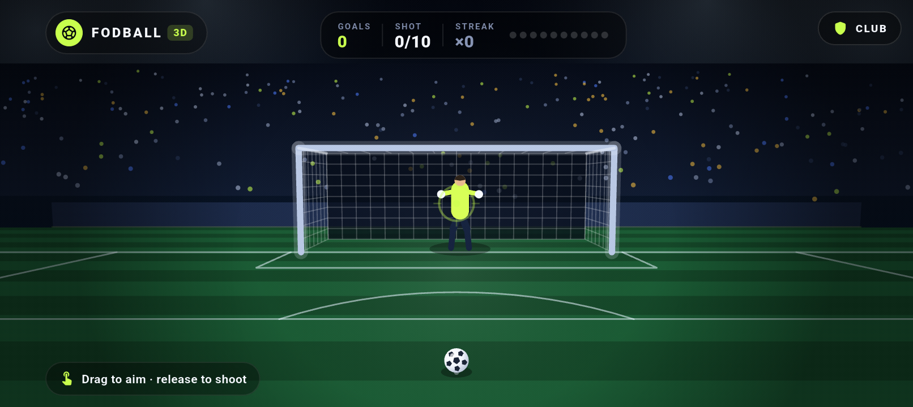

# 🎮 Fodball 3D — o'yin hujjati

Fodball endi **o'ynaladigan 3D penalti o'yini**. Bu hujjat o'yin mexanikasi, boshqaruv
va 3D dvigatel qanday ishlashini tushuntiradi.



## O'yin qoidalari

- Har o'yinda **10 ta penalti**.
- To'p darvoza ichiga tushsa — **GOAL!**, darvozabon ushlasa — **SAVED**, chetga ketsa — **MISS**.
- Ketma-ket gollar **STREAK** hisoblanadi; eng uzun seriya saqlanadi.
- 10 zarbadan keyin **FULL TIME** ekrani: gol soni, aniqlik (accuracy %), eng uzun seriya,
  **PLAY AGAIN** va **CLUB** tugmalari.

## Boshqaruv

| Harakat | Natija |
| --- | --- |
| **Sudrab nishonga olish** (drag) | Nishon darvoza tekisligida siljiydi, kuch shkalasi to'ladi |
| **Qo'yib yuborish** (release) | Zarba bajariladi |
| **Bosish** (tap) | Nishon bosilgan nuqtaga o'rnatiladi va zarba bajariladi |

- Nishon nuqtasi ekrandan **3D nur** (ray) orqali darvoza tekisligiga (`z = 0`) proyeksiyalanadi,
  shuning uchun barmoq qayerda bo'lsa, to'p aynan o'sha tomonga uchadi.
- Kuch qancha yuqori bo'lsa, to'p shuncha tez uchadi (19–34 m/s) va banan effekti shuncha kuchli.
- Darvozabon har zarbada oldingi zarbalardan ko'ra "aqlliroq" o'ynaydi (skill 42% → 88%).

## 3D dvigatel

Tashqi 3D paket **ishlatilmagan** — hammasi `CustomPainter` + matematika:

```
lib/game3d/
├─ vec3.dart          # V3 vektor, Camera3D, Projector (project / unproject / scaleAt)
├─ penalty_game.dart  # o'yin holati, fizika, darvozabon AI, konfetti
└─ game_painter.dart  # butun 3D sahna: osmon, tribuna, maydon, darvoza, to'r, to'p
```

### Perspektiv kamera

- Ko'z nuqtasi: `(0, 1.75, -9.6)` metr, qarash nuqtasi: `(0, 1.15, 0)`.
- Vertikal ko'rish burchagi `fovY = 0.92 rad` (~53°).
- Fokus masofasi: `focal = height / (2 · tan(fovY / 2))` — shu sababli kadr telefon
  ekranining istalgan o'lchamida bir xil ko'rinadi.

Nuqta ekranga shunday tushadi:

```dart
cz = (p - eye) · forward;          // kamera oldidami?
cx = (p - eye) · right;
cy = (p - eye) · up;
screen = (width/2 + cx/cz * focal, height/2 - cy/cz * focal);
```

Teskari amal (`unproject`) ekran nuqtasidan 3D nur yasaydi va uni `z = 0` tekisligi bilan
kesishgan joyini qaytaradi — nishon olish shu asosda ishlaydi.

### Maydon o'lchamlari (real o'lchamlar)

| Narsa | Qiymat |
| --- | --- |
| Darvoza kengligi | 7.32 m (`halfWidth = 3.66`) |
| Darvoza balandligi | 2.44 m |
| To'p radiusi | 0.11 m |
| Penalti nuqtasi | darvozadan 6 m |
| To'r chuqurligi | 2.05 m |

### Fizika

- Har kadrda to'p kichik qadamlar bilan (`≤ 1/240 s`) integrallanadi: tortishish `g = -9.8 m/s²`.
- Yon tezlanish (`curve`) banan effektini beradi, lekin zarba baribir nishonga tegadi.
- To'r chizig'i (`z = 0`) kesilganda `_resolveShot` chaqiriladi: X/Y darvoza ichidami,
  darvozabon qo'li yetadimi — shu tekshiriladi.
- To'r tebranishi (`netRipple`), kamera silkinishi (`shake`), to'p izi (`trail`) va
  konfetti — vizual javob.

### Darvozabon AI

1. `_planKeeper` zarba yo'nalishini "o'qiydi" — ehtimol zarba soni bilan oshadi.
2. O'qimasa, tasodifiy tomonga tashlanadi.
3. Past/yuqori zarbaga qarab tanasi baland yoki pastga uchadi.
4. `keeperCoverX/Y` — qo'l yetadigan nuqta; zarba shu nuqtaga yaqin bo'lsa `SAVED`.

## Chizish tartibi

```
osmon + mayoqlar → tribuna + tomoshabinlar → reklama taxtalari
→ maydon (chiziqli maysa) → maydon belgilari → darvoza + to'r
→ darvozabon → to'p (+ soya, iz) → nishon/traektoriya → konfetti → vinyetka
```

To'p darvoza orqasiga o'tganda (`z > 0.45`) chizish tartibi o'zgaradi — to'p to'r
orqasida ko'rinadi.

## HUD

- Chap yuqorida **FODBALL · 3D** brendi, o'ng yuqorida **CLUB** tugmasi.
- O'rtada hisob: **GOALS**, **SHOT 3/10**, **STREAK ×2** va 10 ta zarba nuqtasi.
- Pastda maslahat va kuch shkalasi (drag paytida).
- Natija banneri: `GOAL!` / `SAVED` / `MISS` + streak.

## Sinovlar

```bash
flutter test
```

`test/game_test.dart` tekshiradi:

- darvoza ekranga to'g'ri joylashishi (o'lcham bo'yicha foizlar);
- zarba uchishi va natija yozilishi;
- 10 zarbadan keyin o'yin tugashi;
- nishon olish (`beginAim` / `updateAim` / `releaseShot`);
- 4 xil landshaft o'lchamida xatosiz chizilish.
